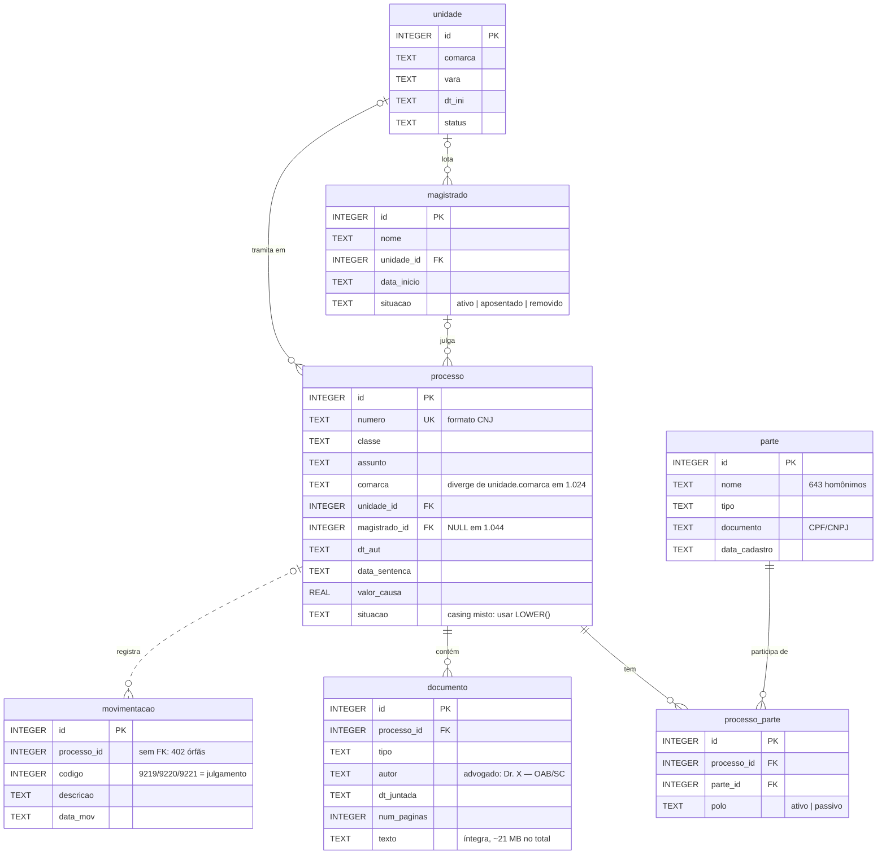
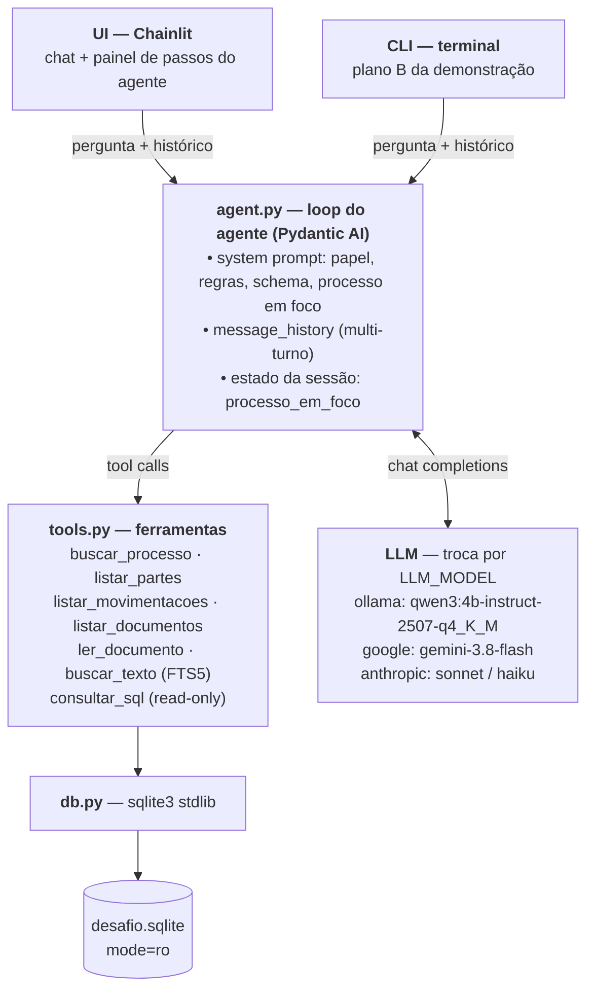
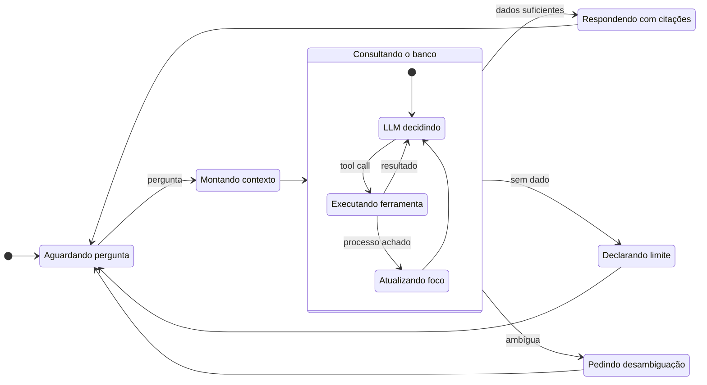
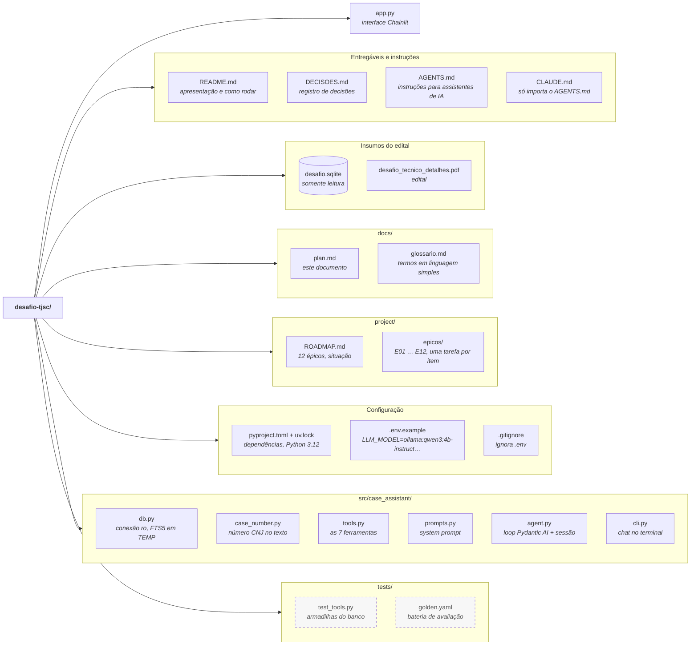

# Plano de arquitetura — Agente de IA sobre dados estruturados (Desafio TJSC)

> Data: 2026-09-22
> Objetivo: chat de IA que responde, em português, perguntas sobre o banco `desafio.sqlite`, consultando-o de forma autônoma, fundamentando as respostas nos dados e reconhecendo limites.

---

## 1. O que o desafio realmente pede

| Requisito | Implicação técnica |
|---|---|
| **Entender** PT natural | LLM interpreta a pergunta e extrai o número do processo (formato CNJ `0000007-79.2023.8.99.9014`) |
| **Consultar autonomamente** | O modelo *decide* que consulta fazer → agente com ferramentas (tool calling), não pipeline fixo |
| **Fundamentar** | Toda resposta cita de onde veio: `documento.id`, tipo, data, movimentação. Precisa de dados estruturados, não de "chunks parecidos" |
| **Conversar** (multi-turno) | Histórico + estado explícito "processo em foco" |
| **Reconhecer limites** | Dizer "não há dado" quando não há — e o banco foi construído para testar isso (ver §2) |
| Minuta de sentença | Geração longa com base nos documentos; rotulada como *proposta*, nunca como sentença proferida |

As 4 perguntas de exemplo do edital são todas **ancoradas em um número de processo específico**. Esse é o fato mais importante do desafio: é busca por chave exata + leitura de documentos relacionados, não busca semântica.

As 5 perguntas da arguição (arquitetura/alternativas; como decide o que consultar e o que acontece quando erra; uso de IA no desenvolvimento; o que ficou de fora; dados reais 10.000× maiores) devem guiar o `DECISOES.md` desde o dia 1.

### Entregáveis exigidos

1. Código-fonte em repositório Git com acesso concedido aos e-mails do convite.
2. `README.md` com instruções de execução.
3. Registro de decisões em Markdown (`DECISOES.md`).
4. Demonstração ao vivo em localhost (sem deploy, domínio, autenticação ou infra de produção).

Testes, cobertura, pipeline e documentação formal são opcionais — se incluídos, explicar o motivo.

---

## 2. O banco — o que foi encontrado (e as armadilhas plantadas)

### Schema

7 tabelas relacionais, `processo` no centro. Linha tracejada = relação sem chave estrangeira declarada no banco.

| Tabela | Linhas |
|---|---:|
| `unidade` | 118 |
| `magistrado` | 200 |
| `processo` | 10.000 |
| `parte` | 14.966 |
| `processo_parte` | 25.086 |
| `documento` | 25.582 |
| `movimentacao` | 134.046 |

Índices existentes: `movimentacao(processo_id)`, `documento(processo_id)`, `processo_parte(processo_id)`, `processo_parte(parte_id)`. Datas em ISO `YYYY-MM-DD` (texto).

### Volumes por processo

- 3–19 documentos (média 7), cada um com 300–2.600 caracteres.
- 1–25 movimentações (média 13).
- Um processo *inteiro* (docs + movimentações + partes) ocupa em média ~2–3k tokens; pior caso ~15k.
- **Cabe inteiro no contexto de um modelo pequeno** — chunking é desnecessário.

### Armadilhas deliberadas

O requisito "Reconhecer limites" é testado aqui.

| Armadilha | Números | Consequência para o agente |
|---|---|---|
| **63% dos processos não têm documentos** | 6.309 de 10.000 | "Resuma o processo X" → responder com movimentações e dizer que não há peças; minuta impossível |
| `situacao` com casing inconsistente | `Julgado`, `JULGADO`, `julgado` | `WHERE situacao='Julgado'` erra. Normalizar com `LOWER()` |
| `data_sentenca` preenchida sem documento de Sentença | 4.426 | "Já foi julgado?" → "consta data de sentença, mas o texto não está disponível; fundamentos desconhecidos" |
| Documento de Sentença sem `data_sentenca` | 37 | Conflito metadado × documento → reportar o conflito |
| `situacao='julgado'` sem `data_sentenca` | 43 | idem |
| `magistrado_id` NULL | 1.044 | "Quem é o magistrado?" → não consta na tabela; pode aparecer só no texto do despacho |
| `processo.comarca` ≠ `unidade.comarca` | 1.024 | Reportar divergência, não escolher silenciosamente |
| Movimentações órfãs (processo inexistente) | 402 | Ignoradas por JOIN; nunca aparecem |
| Homônimos em `parte` (mesmo nome, CPF diferente) | 643 nomes | "Processos da Maria Torres" → pedir desambiguação |
| Juízes aposentados/removidos titulares de processos | 2.022 | Só reportar; não inferir |
| Unidades desativadas com processos | 746 | idem |
| `valor_causa` NULL ou ≤ 0 | 598 / 288 | "Valor da causa não informado" |
| **Advogados não têm tabela** | — | Estão só em `documento.autor` ("Dr. X — OAB/SC 99.170") e no texto. Sem documentos → sem advogados |
| Metadado `autor` divergente da assinatura no texto | visto no proc. 3161 | Citar a fonte e apontar a divergência |
| Conteúdo sintético incoerente (ex.: "Acidente de Trânsito" contra "Operadora de Saúde") | frequente | O agente descreve o que os autos dizem, sem "corrigir" |

### Processos de referência para demo e testes

- **Processo rico:** id 3161 — `0000007-79.2023.8.99.9014`. 19 documentos: petição inicial, contestação, réplica, saneamento, ata de audiência, sentença parcialmente procedente com fundamentos, embargos, apelação, contrarrazões. Juiz titular aposentado.
- **Processo sem documentos:** id 1 — `0000001-43.2021.8.99.9014`. 16 movimentações, zero documentos, `situacao='julgado'` (minúsculo), `data_sentenca` preenchida.

---

## 3. Decisão central: RAG vetorial × Text-to-SQL × ferramentas tipadas

A intuição inicial de RAG (chunks + embeddings em Qdrant) é o caminho natural quando os dados são texto não estruturado. Aqui é a ferramenta errada, por razões concretas do banco:

| Critério | RAG vetorial (Qdrant + embeddings) | Agente sobre SQL |
|---|---|---|
| Perguntas ancoradas em número de processo | Busca semântica é ruim com chaves exatas; "0000007-79.2023" vira ruído no embedding | `WHERE numero = ?` — exato, instantâneo |
| "Quem são as partes / magistrado / valor da causa" | Está em colunas, não em texto. Precisaria serializar linhas em texto para depois recuperá-las por similaridade | Um JOIN |
| Fundamentar a resposta | Cita "chunk #4127" | Cita `documento 7878 (Sentença, 18/02/2026)` |
| Documento inteiro cabe no contexto | Chunking desnecessário e ainda **quebra a sentença** no meio dos fundamentos | Lê o documento completo |
| "Reconhecer limites" | Top-k *sempre* retorna algo, com score alto ou baixo → alucinação por similaridade | Retornou 0 linhas → "não consta" |
| Multi-turno / agregações ("quantos processos dessa vara?") | Impossível | Trivial |
| Infra em 8 GB RAM | Qdrant + modelo de embedding + LLM, três processos disputando memória, mais um passo de indexação | `sqlite3` da stdlib. Zero infra |
| Troca de LLM | Embeddings acoplados ao modelo de embedding escolhido | Nada muda |

**Onde busca semântica agregaria valor:** "encontre processos parecidos com este" ou "sentenças que trataram de inversão do ônus da prova". Está fora do escopo pedido. Se um dia precisar, `sqlite-vec` (extensão que mantém tudo no mesmo arquivo `.sqlite`) resolve sem Qdrant. Registrar no `DECISOES.md` como "alternativa descartada e próximo passo".

**Busca textual** por nome ou termo ("processos em que aparece 'inversão do ônus'"): **FTS5 já está compilado no SQLite local** (`ENABLE_FTS5` verificado, SQLite 3.51). Índice full-text sobre `documento.texto` e `parte.nome` custa 10 linhas de SQL e nenhuma dependência.

### Por que não Text-to-SQL livre

Modelo de 4B inventa colunas, esquece o `LOWER(situacao)`, erra JOINs. A solução é **híbrida**:

1. **Ferramentas tipadas** (6–8 funções Python com SQL escrito à mão, parâmetros validados) cobrem ~95% das perguntas. O modelo só escolhe *qual* ferramenta e com *quais* argumentos — decisão fácil para 4B.
2. **`consultar_sql`** como válvula de escape para perguntas imprevistas — só `SELECT`, conexão *read-only*, `LIMIT` forçado, timeout, schema no prompt. Erros do SQLite voltam ao modelo como observação; ele tenta de novo até 2×, depois declara que não conseguiu.

Resposta pronta para a arguição #2: *"O agente decide via tool calling sobre um conjunto fechado de ferramentas com contratos explícitos; quando erra, o erro é devolvido como observação e há um teto de tentativas; o SQL livre nunca escreve no banco."*

---

## 4. Arquitetura

### Componentes

### Estados de um turno de conversa

- **Montando contexto:** junta system prompt, `processo_em_foco` e histórico antes de chamar o LLM.
- **Executando ferramenta:** listagens devolvem só metadados; texto apenas via `ler_documento`. Erro do SQLite volta ao LLM como observação.
- **Atualizando foco:** `buscar_processo` grava o processo encontrado em `processo_em_foco`.
- **Pedindo desambiguação:** nomes homônimos, ou pergunta sem número de processo e sem foco na sessão.
- **Declarando limite:** o dado não existe na base, ou o teto de tentativas de ferramenta foi atingido. Pedido de minuta sem petição inicial e contestação cai aqui.
- **Respondendo com citações:** toda afirmação cita documento ou movimentação; minuta abre com "PROPOSTA DE MINUTA — texto não proferido".

### Ferramentas

| Ferramenta | Entrada | Saída | Observações |
|---|---|---|---|
| `buscar_processo` | `numero` (ou usa foco) | Cabeçalho: classe, assunto, comarca, vara, magistrado (+ situação dele), datas, valor, `situacao` normalizada, campo derivado `julgamento` (cruza `data_sentenca` + mov. 9219/9220/9221 + doc Sentença), contagem de docs/movs, divergências detectadas | Grava `processo_em_foco` na sessão |
| `listar_partes` | `numero` | Partes por polo, tipo, documento (CPF/CNPJ) | Advogados vêm de `listar_documentos` (campo `autor`) |
| `listar_movimentacoes` | `numero` | Lista cronológica (código, descrição, data) | Compacta |
| `listar_documentos` | `numero` | Metadados: id, tipo, autor, data, páginas, tamanho — **sem texto** | Advogados = autores com "OAB" |
| `ler_documento` | `id` | Texto completo | Só sob demanda |
| `buscar_texto` | `termo`, opcional `tipo`/`numero` | Hits FTS5 com snippet e ids | Para termos e nomes |
| `search_cases` (T3.11, D36) | filtros: assunto, classe, comarca, vara, magistrado, situação, datas, valor; ordenação; limite | Total + lista compacta (número, classe, assunto, comarca, situação, data, valor) | Perguntas "quais/quantos processos…" sem SQL do modelo; texto comparado sem acento/caixa |
| `consultar_sql` | `sql` | Linhas (máx. 50) | Só `SELECT`/`WITH`; sem `;`, `PRAGMA`, `ATTACH`; timeout 5 s; conexão `mode=ro` |

Ferramentas retornam **dados compactos por padrão e texto completo só sob demanda**. É isso que faz funcionar em 8 GB: o modelo nunca recebe 19 documentos de uma vez a menos que peça.

### Fluxo de "Resuma o processo X"

1. LLM extrai o número → `buscar_processo("0000007-79...")` → cabeçalho. Sessão grava o processo em foco.
2. LLM chama `listar_movimentacoes` e `listar_documentos` (metadados).
3. Decide quais ler: `ler_documento(7865)` (Petição Inicial), `ler_documento(7878)` (Sentença).
4. Redige o resumo citando `[doc 7865 — Petição Inicial, 08/01/2024]`.

### Contexto multi-turno

Além do histórico de mensagens, o `processo_em_foco` é injetado no system prompt a cada turno. Modelos pequenos perdem o fio em históricos longos; uma variável explícita é mais barata e robusta. Se a pergunta seguinte não citar número, as ferramentas usam o foco.

### Regras do system prompt (as que resolvem as armadilhas)

- Nunca afirmar algo que não veio de uma ferramenta; citar o `id` do documento ou a movimentação.
- Se `listar_documentos` retornar vazio, dizer que o processo não tem peças disponíveis e responder apenas com movimentações.
- Se metadado e documento divergirem (ex.: `data_sentenca` sem Sentença), reportar a divergência.
- Minuta: sempre iniciar com "**PROPOSTA DE MINUTA — texto não proferido**", baseada só nos documentos lidos; se não houver petição inicial e contestação, recusar e explicar.
- Nunca deduzir situação de julgamento por nome de juiz ou por `situacao` isolada; cruzar com movimentação `9219/9220/9221` e com o documento de Sentença.
- Quando houver homônimos, listar as opções e pedir desambiguação.

---

## 5. Stack e justificativas

| Camada | Escolha | Por quê | Descartado |
|---|---|---|---|
| Linguagem | **Python 3.12+** via `uv` | `sqlite3` na stdlib; ecossistema de IA; qualquer avaliador lê. `uv run` reproduzível sem virtualenv manual. Python local é 3.14 — pinar 3.12 evita wheel faltando | TypeScript (ecossistema de agentes local menos maduro; sqlite precisa de binding nativo) |
| Agente | **Pydantic AI** | Loop de tool calling pronto; ferramentas = funções Python tipadas (schema JSON sai dos type hints); **model-agnostic por string** (`ollama` via endpoint OpenAI-compatível, `anthropic:`, `openai:`, `groq:`); `message_history` nativo; sem camadas mágicas. ~150 linhas de código próprio | LangChain/LangGraph (abstrações pesadas e instáveis; difícil explicar na arguição), LlamaIndex (centrado em RAG), CrewAI/AutoGen (multi-agente é overkill). Loop manual com `litellm` é válido, mas reimplementa normalização de tool-calls entre provedores |
| Banco | **SQLite direto, read-only** + FTS5 | Zero infra; o desafio *é* esse arquivo. `mode=ro` garante que nenhum SQL gerado escreva | Qdrant/Chroma (§3); DuckDB (não há analítica pesada) |
| LLM local | **`qwen3:4b-instruct-2507-q4_K_M`** no Ollama (D25) | Melhor tool calling da faixa 4B, bom em PT-BR, Q4_K_M ≈ 2,5 GB; variante *instruct*, sem modo raciocínio — a etiqueta `qwen3:4b` hoje é só-raciocínio e ignora `think=False` | `llama3.1:8b` (4,9 GB + KV cache não sobra RAM), `gemma3:4b` (sem tool calling no Ollama), `llama3.2:3b` (tool calling fraco) |
| LLM nuvem (demo) | **Gemini 3.8 Flash** via `google:` (plano gratuito, D30); **Claude Sonnet 5** via `anthropic:` como opção com crédito | Mesmo código, troca `LLM_MODEL` no `.env`. Ter os dois na apresentação mostra portabilidade e protege contra o modelo local travar ao vivo | — |
| UI | **Chainlit** | Chat pronto em ~40 linhas e **mostra cada tool call e resultado como "passo" colapsável** — o avaliador vê o agente decidir. Demonstra "Fundamentar" visualmente | Streamlit (exibir tool calls exige código extra), Gradio, React (custo sem retorno) |
| Testes | `pytest` — testes das ferramentas (sem LLM) + golden set de ~12 perguntas | Opcional pelo edital; incluir e explicar: ferramentas são determinísticas e cobrem as armadilhas; golden set é a regressão ao mexer no prompt | cobertura, CI |

### Orçamento de memória (MacBook M1, 8 GB)

| Item | RAM |
|---|---|
| `qwen3:4b-instruct-2507` Q4_K_M pesos | ~2,5 GB |
| KV cache, `num_ctx=16384`, `OLLAMA_KV_CACHE_TYPE=q8_0` | ~1,2 GB |
| macOS + servidor Chainlit + Python | ~2,5 GB |
| Navegador com **só a aba do Chainlit** (Safari) | ~0,5 GB |
| **Total** | **~7 GB** — cabe, com pouca folga |

A estimativa **não inclui** outros programas abertos (IDE, navegador do dia a dia, mensageiros). Por isso: Safari só com a aba do Chainlit e todo o resto fechado. A apresentação é **presencial** (edital); se passar a ser remota, a videochamada (Google Meet em outro navegador) pode consumir sozinha 1 GB ou mais, e a tarefa opcional T11.6 mede esse cenário antes de decidir entre modelo local e em nuvem (D22, D28).

Contexto de 16k tokens cabe o pior processo (19 docs ≈ 15k tokens) se o modelo ler tudo — mas o design "metadados primeiro, texto sob demanda" faz o caso comum ficar em 3–5k. O modelo padrão é a variante *instruct*, sem modo raciocínio (*thinking*): responde direto, o que corta a latência (D25).

Fallback se ficar apertado: `qwen3:1.7b` (1,7 GB carregado) — mais rápido e mais leve, pior em redação; ver o comparativo abaixo.

### Comparativo de modelos (medido)

Mesmo computador (MacBook M1, 8 GB), mesma pergunta — *"Responda em português, em até 5 frases: o que é uma petição inicial?"* —, 3 rodadas por modelo, contexto de 4 mil tokens, sem modo raciocínio. Medido em 25/09/2026 nas tarefas T1.2 e T1.8; Gemini na T1.9; Claude na T1.10, opcional.

| | `qwen3:4b-instruct-2507` (padrão) | `qwen3:1.7b` (reserva) | Gemini (nuvem) | Claude (nuvem, opcional) |
|---|---|---|---|---|
| Onde roda | local (Ollama) | local (Ollama) | nuvem (Google) | nuvem (Anthropic) |
| Raciocínio desligado (`think=false`) | não se aplica: variante sem raciocínio | funciona | nível `minimal` recusado pelo modelo; `low` zera o raciocínio (0 tokens). No padrão, raciocina 470–700 tokens antes de responder | a medir (T1.10) |
| Velocidade de geração | ~19 tok/s | ~41 tok/s | não mensurável: a resposta chega num bloco só (no padrão, 214–328 tok/s de texto visível) | a medir (T1.10) |
| Tempo total, modelo já carregado | 6,3–6,8 s | 2,6–2,7 s | padrão: 3,0–4,2 s · `low`: 2,7–20,3 s (fila do plano gratuito) | a medir (T1.10) |
| Primeira resposta (inclui carregar o modelo) | 12,2 s | 5,4 s | não se aplica | não se aplica |
| Memória do Mac ocupada pelo modelo | 3,2 GB | 1,7 GB | ~0 (roda fora) | ~0 (roda fora) |
| Swap durante o teste | subiu ~1,4 GB | não subiu | não se aplica | a medir (T1.10) |
| Qualidade do texto | correto e fluente; um erro de conteúdo ("ação civil, criminal ou administrativa" — no penal a peça inicial é a denúncia/queixa) | erros de concordância ("para que ela ouvam o caso") e de conteúdo (trata "contestações" como tipo de ação) | correto, fluente e completo; sem erro de conteúdo (cita partes, fatos, fundamentos, pedidos, valor da causa e a inércia do Judiciário) | a medir (T1.10) |

Achados do Gemini no plano gratuito (T1.9):
- **O limite de tokens de saída inclui o raciocínio.** Com limite de 400 tokens e raciocínio padrão, gastou 383 pensando e cortou a resposta no meio. O agente precisa fixar o nível de raciocínio em `low` (ou dar limite folgado) ao usar o Gemini.
- **Instabilidade:** uma chamada recusada com erro 503 ("alta demanda") e tempo de resposta variando de 2,7 s a 20,3 s na mesma pergunta. Bom para experimento; para a apresentação, o modelo local é o caminho previsível.

Descartado antes do comparativo: `qwen3:4b` (etiqueta atual, só-raciocínio) — ignora `think=false`, raciocina em inglês e esgotou 400 tokens sem responder (D25).

Este teste mede **velocidade e memória** com uma pergunta simples, sem ferramentas. Qual modelo vai para a demonstração depende da bateria de avaliação (T9.5, T11.5): escolher a ferramenta certa, respeitar o "não consta" e redigir a minuta.

Ambiente local verificado: Ollama instalado (modelos presentes: `llama3.1:8b`, `nomic-embed-text`, `qwen2.5-coder:1.5b`); `uv` ausente (`brew install uv`); Node presente.

---

## 6. Estrutura do projeto

Borda contínua = arquivo que já existe (os módulos `tools`, `prompts`, `agent`, `cli` e `app.py` ainda são esqueletos, preenchidos nos épicos indicados na docstring de cada um) · borda tracejada = planejado. Grupos com `/` no nome são pastas; os demais (Entregáveis, Insumos, Configuração) só agrupam arquivos da raiz.

Os nomes dos arquivos de código seguem a regra de identificadores em inglês (D19). O pacote `src/case_assistant/` (D23) substitui o `src/agente/` das versões anteriores deste plano.

`cli.py` antes de `app.py` força a separação agente/UI e serve de plano B na demonstração.

---

## 7. Plano de execução

| Fase | Entrega | Verificação |
|---|---|---|
| **0 — Setup** (½ dia) | `brew install uv`, `uv init`, `ollama pull qwen3:4b-instruct-2507-q4_K_M`, `git init`, esqueleto, `DECISOES.md` com a decisão RAG × SQL | `uv run python -c "import sqlite3"`; Ollama responde |
| **1 — Ferramentas** (1 dia) | `db.py` + `tools.py` com as 7 funções e normalizações; testes unitários das armadilhas | `pytest` verde sem LLM |
| **2 — Agente CLI** (1 dia) | `agent.py` + `prompts.py` + `cli.py`; roda com `ollama` e com `anthropic` trocando env | As 4 perguntas do edital no processo 3161 e no processo 1 |
| **3 — Limites e minuta** (1 dia) | Regras de "não consta"; template da minuta com disclaimer; `processo_em_foco` | Golden set: processo sem docs, sem magistrado, sentença sem texto, homônimo |
| **4 — UI** (½ dia) | Chainlit com passos visíveis; seletor de modelo | Demo end-to-end |
| **5 — Ajuste do modelo local** (½ dia) | `num_ctx`, KV q8, tamanho das respostas das tools | Latência < 30 s por resposta no M1 |
| **6 — Entregáveis** (½ dia) | README, DECISOES.md completo, roteiro da demo, respostas da arguição | Alguém sem contexto sobe em 5 min |

Total: ~5 dias de trabalho concentrado. Se o prazo for menor, cortar a Fase 4 (fica no CLI) — nunca a Fase 3.

---

## 8. Respostas prontas para a arguição

1. **Por que essa arquitetura e não outra?** Perguntas ancoradas em chave exata + dados majoritariamente estruturados + documentos que cabem no contexto → agente sobre SQL. RAG vetorial descartado (§3); FTS5 cobre busca textual; `sqlite-vec` é o caminho se busca semântica virar requisito.
2. **Como decide o que consultar? O que acontece quando erra?** Tool calling sobre ferramentas tipadas; SQL livre só leitura com `LIMIT`/timeout; erro vira observação; teto de 2 tentativas; depois declara limite. Mostrar ao vivo uma pergunta que falha de propósito.
3. **Como usou IA no desenvolvimento?** Registrar no `DECISOES.md` conforme avança: o que o assistente fez, prompts, onde errou (ex.: sugerir RAG por reflexo, esquecer o casing de `situacao`).
4. **O que não fez por falta de tempo?** Busca semântica, cache de respostas, avaliação sistemática com LLM-juiz, streaming da minuta, extração de advogados para uma tabela própria.
5. **Dados reais, sigilosos, 10.000×?** Postgres com RLS e views por perfil; PII mascarada antes de chegar ao LLM (ou LLM on-premise — o suporte a Ollama já demonstra); `consultar_sql` livre desligado em produção (só ferramentas auditadas); log de toda consulta; índices por `numero`; o padrão "metadados primeiro, texto sob demanda" escala sem mudança de design.

---

## 9. Riscos

| Risco | Mitigação |
|---|---|
| O modelo local alucina argumento ou ignora "não consta" | Golden set + regra no prompt + a UI mostra a fonte, então o erro é visível, não escondido. Demo com Claude como plano B |
| Latência da minuta no M1 (~1.500 tokens de saída) | Streaming na UI (modelo *instruct*, sem raciocínio); ou minuta com o modelo em nuvem |
| RAM estourar ao vivo | `num_ctx=8192`, fechar apps, `qwen3:1.7b` no bolso |
| Modelo pequeno confunde `situacao` vs. movimentação de sentença | `buscar_processo` já retorna o campo derivado `julgamento` cruzando os três sinais, para o modelo não ter que raciocinar |

---

## 10. Próximo passo

Fase 0 + Fase 1 (ferramentas + testes das armadilhas): não dependem de LLM nenhum e são a base que justifica toda a arquitetura na arguição.
